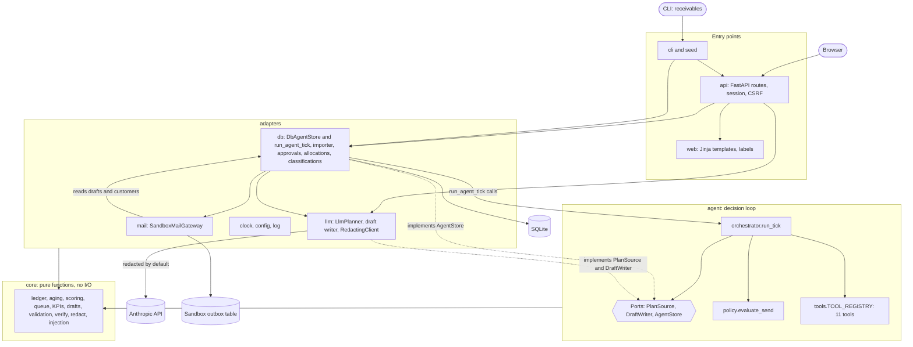
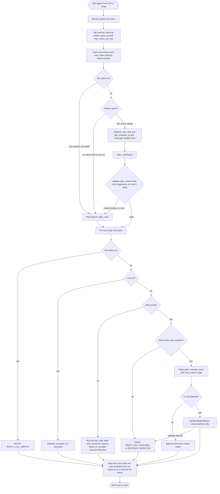
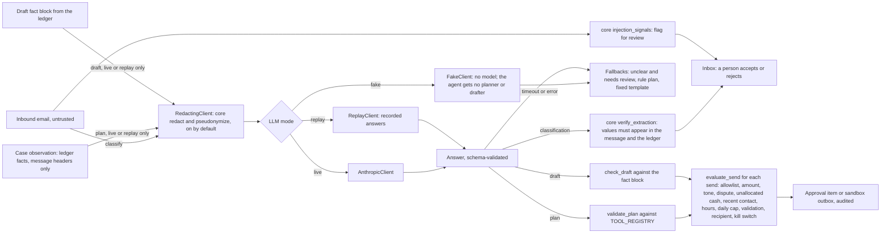

# Architecture

One page for evaluators and contributors: how the code is layered, how one agent tick runs, and where the policy gate and the LLM sit. Synthetic data only. `tests/test_architecture_doc.py` checks this page against the code: the dependency table must equal the real imports, and every module and name below must exist.

## 1. Ports and adapters

The pure core holds every financial rule; the agent holds the decision loop and declares the ports it needs; adapters implement them with SQLite, the Anthropic API (behind redaction, which `config.yaml` turns on by default), a sandbox mail outbox and the clock. The web app (pages and JSON API) and the CLI are the entry points. The web app and the manual scripts reach the agent through `adapters/db/agent_store.py` `run_agent_tick`; the CLI only manages data (`reset`, `seed`, `create-user`, `sim-create`, which writes the seeded simulation company to its own `sim_<seed>.db`, and `sim-run`, which runs the simulator's arms A0 to A3 on their own databases with the rule planner and no LLM) and never runs the agent. `adapters.db` and `adapters.mail` use each other: the store delivers through the gateway, and the gateway reads drafts and customers.

**Dependency rules** (between packages under `src/receivables/`; the test compares this table with the real imports):

| Package | Imports from | Enforced by |
|---|---|---|
| `core` | (nothing) | T-ARCH-01 (`tests/architecture/test_core_purity.py`): no framework, I/O, network, database, clock or outer layer |
| `agent` | `core` | T-ARCH-01: no wall clock in `agent/`; time is injected |
| `settings` | (nothing) | environment only; never reads `.env` itself |
| `adapters.clock` | (nothing) | the only source of the current date and time; `core` and `agent` are given the time (T-ARCH-01) |
| `adapters.config` | `core` | |
| `adapters.log` | `core` | |
| `adapters.llm` | `adapters.config`, `agent`, `core`, `settings` | `tests/architecture/test_llm_fence.py`: only `adapters/llm/anthropic_client.py` may import the Anthropic SDK or an HTTP client |
| `adapters.mail` | `adapters.clock`, `adapters.db` | T-MAIL-01: imports no network client |
| `adapters.db` | `adapters.clock`, `adapters.config`, `adapters.llm`, `adapters.mail`, `agent`, `core` | |
| `seed` | `adapters.clock`, `adapters.db` | |
| `sim` | `adapters.clock`, `adapters.config`, `adapters.db`, `adapters.llm`, `agent`, `core` | T-SIM-04: writes only its own `sim_<seed>*.db` and results file, never the real database; its only LLM client is the fake one (T-SIM-01) |
| `web` | `core` | |
| `cli` | `adapters.clock`, `adapters.config`, `adapters.db`, `api`, `core`, `seed`, `settings`, `sim` | |
| `api` | `adapters.clock`, `adapters.config`, `adapters.db`, `adapters.llm`, `adapters.log`, `agent`, `core`, `settings`, `web` | |

## 2. The agent loop (one tick)

`adapters/db/agent_store.py` `run_agent_tick` opens one write transaction and calls `agent/orchestrator.py` `run_tick` with the store, the clock's time and the planner and drafter of the LLM mode. Each case and each step runs in its own savepoint, so a failing case or step is rolled back alone and recorded. With the kill switch on or at L0 nothing about the cases is saved, only the trace.

With the kill switch on, the planner is not called and every step is denied with `POLICY_KILL_SWITCH`; at L0 every step is recorded as skipped. A step that raises is recorded as failed and rolled back alone. Drafts come from `agent/drafting.py` `generate_draft`: the LLM draft writer is tried and checked by `core/draft_validator.py` `check_draft` against the fact block; after the allowed regenerations, the fixed template is used. People act outside the tick through the API and pages: approve or reject drafts and approval items (`adapters/db/approvals.py` `decide_approval`), mark drafts sent, accept classifications, allocate payments (`adapters/db/allocations.py` `allocate_payment`); each writes an audit row.

## 3. The policy gate and the LLM path

Inbound email is untrusted data: it reaches the classifier only, as quoted text after redaction, and its result is verified by code before a person can accept it; a suspected instruction-injection also sends it to review. Plans and drafts are validated before anything happens. Every send to a customer passes the policy engine; internal steps (drafts, tasks, document requests, follow-ups, escalation, allocation proposals) are limited by the kill switch and the autonomy level, and an allocation proposal still needs a person.

Every failure has a safe fallback: an invalid or failed classification becomes "unclear, needs review"; a rejected or failed plan becomes the rule planner's; a draft that keeps failing validation becomes the fixed template. No model output can change an invoice, a payment or a recipient: no tool writes the ledger, no tool has an amount or recipient argument (free text such as a task's text is never used as one), the recipient always comes from the customer's stored address, and the gateway checks it again.

## Where things live

| Module | Names |
|---|---|
| `src/receivables/agent/orchestrator.py` | `run_tick`, `PlanSource`, `AgentStore`, `recheck_draft` |
| `src/receivables/agent/drafting.py` | `DraftWriter`, `generate_draft` |
| `src/receivables/agent/plans.py` | `validate_plan` |
| `src/receivables/agent/policy.py` | `evaluate_send`, `send_facts_from` |
| `src/receivables/agent/tools.py` | `TOOL_REGISTRY` |
| `src/receivables/agent/rules_planner.py` | `plan_case` |
| `src/receivables/agent/cases.py` | `transition` |
| `src/receivables/agent/outcomes.py` | `infer_outcomes`, `promise_outcome` |
| `src/receivables/core/draft_validator.py` | `check_draft` |
| `src/receivables/core/verify.py` | `verify_extraction` |
| `src/receivables/core/redact.py` | `redact`, `pseudonymize` |
| `src/receivables/core/injection.py` | `injection_signals` |
| `src/receivables/adapters/db/agent_store.py` | `DbAgentStore`, `run_agent_tick` |
| `src/receivables/adapters/db/approvals.py` | `decide_approval` |
| `src/receivables/adapters/db/allocations.py` | `allocate_payment` |
| `src/receivables/adapters/db/controls.py` | `kill_switch_on` |
| `src/receivables/adapters/db/classifications.py` | `classify_stored` |
| `src/receivables/adapters/llm/planner.py` | `LlmPlanner` |
| `src/receivables/adapters/llm/drafter.py` | `make_draft_writer` |
| `src/receivables/adapters/llm/redacting.py` | `RedactingClient` |
| `src/receivables/adapters/llm/anthropic_client.py` | `AnthropicClient` |
| `src/receivables/adapters/llm/replay.py` | `ReplayClient` |
| `src/receivables/adapters/llm/fake.py` | `FakeClient` |
| `src/receivables/adapters/mail/sandbox.py` | `SandboxMailGateway` |
| `src/receivables/adapters/clock.py` | `Clock`, `SimulatedClock` |
| `src/receivables/sim/company.py` | `generate_company`, `SimCompany` |
| `src/receivables/sim/behaviour.py` | `CustomerBehaviour`, `behaviours_for` |
| `src/receivables/sim/simulator.py` | `create_sim_db`, `sim_db_path` |
| `src/receivables/sim/runner.py` | `run_arms`, `ARMS` |
| `src/receivables/sim/shadow.py` | `capture_rate`, `oldest_first`, `largest_first` |
| `src/receivables/api/main.py` | `create_app` |

Behaviour and acceptance tests: `docs/SPEC.md`; decisions: `docs/DECISIONS.md`; the test report by spec test ID: `docs/TEST_REPORT.md`.
